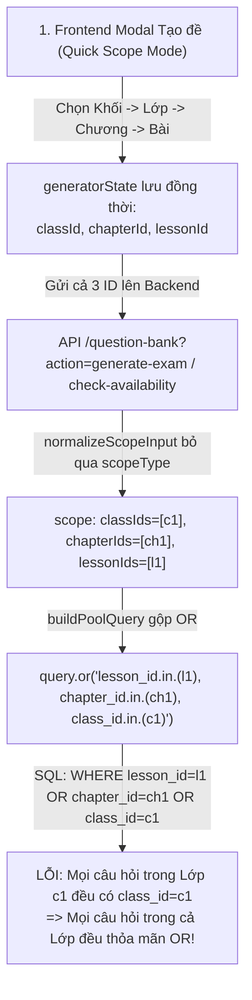

# 📋 KẾ HOẠCH RÀ SOÁT & SỬA LỖI LỌC NGÂN HÀNG ĐỀ THI (QUESTION BANK FILTER FIX PLAN)

> **TRẠNG THÁI: ĐÃ TRIỂN KHAI (16/10/2026)** — Backend `normalizeScopeInput` nhận `scopeType`, `buildPoolQuery` lọc đúng 1 cấp ở QUICK / mở rộng phân cấp chống nuốt scope ở MULTI; modal ma trận chỉ gửi đúng 1 cấp; thanh lọc chính có thêm dropdown Lớp học (Khối → Lớp → Chương → Bài). Đã verify bằng harness trích pure function: 14/14 test pass (QUICK LESSON/CHAPTER/CLASS/BLOCK + MULTI mở rộng + legacy).
> Lưu ý deploy: cần deploy lại Edge Function `question-bank` để backend mới có hiệu lực.

> **Mục tiêu:** Khắc phục triệt để lỗi bộ lọc Ngân hàng đề thi chỉ lấy theo Lớp học (`class_id`), bỏ qua các điều kiện lọc theo Chương học (`chapter_id`) và Bài học (`lesson_id`) khi xem danh sách và khi sinh đề thi theo ma trận.

---

## I. MÔ TẢ VẤN ĐỀ (PROBLEM STATEMENT)

- **Hiện trạng:** Khi người dùng vào chức năng Ngân hàng câu hỏi hoặc mở Modal **Tạo đề theo Ma trận**:
  - Dù đã chọn chi tiết **Chương học** (ví dụ: *Chương 1 - Khảo sát hàm số*) hoặc **Bài học** (ví dụ: *Bài 1 - Sự đồng biến nghịch biến*).
  - Hệ thống vẫn trả về toàn bộ câu hỏi của **toàn bộ Lớp học** (bao gồm cả Chương 2, Chương 3, Bài 5, Bài 10...).
  - Badge kiểm tra số lượng câu khả dụng (`check-availability`) hiển thị tổng số câu của cả lớp, và khi bấm bốc câu hỏi (`generate-exam`), đề thi bị lẫn lộn câu hỏi từ các chương/bài khác.

---

## II. PHÂN TÍCH NGUYÊN NHÂN GỐC RỄ (ROOT CAUSE ANALYSIS)



### 1. Nguyên nhân 1 (Trọng yếu nhất): Lỗi toán tử `OR` trong `buildPoolQuery` (Backend)
- **Vị trí file:** `supabase/functions/question-bank/index.ts` (Dòng 364 – 385).
- **Cơ chế lỗi:**
  1. Khi người dùng chọn phạm vi là `LESSON` (Bài học) hoặc `CHAPTER` (Chương), giao diện Frontend sử dụng các dropdown xếp tầng (Cascading): **Khối $\rightarrow$ Lớp $\rightarrow$ Chương $\rightarrow$ Bài**.
  2. Frontend gửi đồng thời cả `classId`, `chapterId` và `lessonId` lên Backend.
  3. Hàm `normalizeScopeInput` (dòng 267 – 275) không kiểm tra `scopeType` mà gom tất cả các trường có giá trị vào mảng:
     - `classIds: ['id-lop-12A1']`
     - `chapterIds: ['id-chuong-1']`
     - `lessonIds: ['id-bai-1']`
  4. Hàm `buildPoolQuery` tạo câu truy vấn PostgREST:
     ```typescript
     const orClauses: string[] = []
     if (scope.lessonIds && scope.lessonIds.length > 0) {
       orClauses.push(`lesson_id.in.(${scope.lessonIds.join(',')})`)
     }
     if (expandedChapterIds && expandedChapterIds.length > 0) {
       orClauses.push(`chapter_id.in.(${expandedChapterIds.join(',')})`)
     }
     if (expandedClassIds && expandedClassIds.length > 0) {
       orClauses.push(`class_id.in.(${expandedClassIds.join(',')})`)
     }

     if (orClauses.length > 0) {
       query = query.or(orClauses.join(',')) // <-- BUG TẠI ĐÂY
     }
     ```
  5. Trong cơ sở dữ liệu PostgreSQL, câu lệnh này trở thành:
     ```sql
     WHERE lesson_id IN ('id-bai-1')
        OR chapter_id IN ('id-chuong-1')
        OR class_id IN ('id-lop-12A1')
     ```
  6. **Hậu quả:** Mọi câu hỏi thuộc Lớp 12A1 đều có `class_id = 'id-lop-12A1'`. Do đó mệnh đề `OR class_id IN (...)` đánh giá `TRUE` cho **toàn bộ câu hỏi trong lớp**. Bộ lọc theo Bài học và Chương học bị vô hiệu hóa hoàn toàn!

### 2. Nguyên nhân 2: Khuyết bộ lọc "Lớp học" trên thanh Filter trang chính
- **Vị trí file:** `fe/src/js/views/question-bank.js` (Dòng 174 – 215).
- Theo tài liệu đặc tả `QUESTION_BANK_SPEC_AND_LOGIC.md`, hệ thống phân tầng danh mục chuẩn là:
  $$\text{Khối học (grade\_block)} \longrightarrow \text{Lớp học (class\_id)} \longrightarrow \text{Chương (chapter\_id)} \longrightarrow \text{Bài học (lesson\_id)}$$
- Tuy nhiên trên thanh công cụ lọc của trang Ngân hàng câu hỏi hiện tại chỉ có:
  - Khối học (`qb-filter-grade-block`)
  - Chương học (`qb-filter-chapter`)
  - Bài học (`qb-filter-lesson-wrap`)
- Giao diện **bị khuyết dropdown "Lớp học"**. Hàm `loadChaptersForGradeBlock` phải tự động gom tất cả các chương của mọi lớp trong khối vào chung một select, làm trộn lẫn chương giữa các lớp khác nhau trong cùng một khối.

### 3. Nguyên nhân 3: Xử lý chuỗi điều kiện trong API `GET /question-bank`
- **Vị trí file:** `supabase/functions/question-bank/index.ts` (Dòng 710 – 721 và Dòng 620 – 631).
- Đoạn code sử dụng `if ... else if ... else if`:
  ```typescript
  if (filterLessonIds.length > 0) {
    query = query.in('lesson_id', filterLessonIds)
  } else if (chapterId) {
    query = query.eq('chapter_id', chapterId)
  } else if (classId) {
    query = query.eq('class_id', classId)
  } else if (gradeBlock) {
    ...
  }
  ```
- Nếu một câu hỏi trong DB được import mà giáo viên chưa kịp gán `chapter_id` hoặc `lesson_id` (chỉ gán `class_id`), khi lọc theo Chương/Bài câu hỏi đó sẽ bị ẩn hoàn toàn. Cần chuẩn hóa dữ liệu và cung cấp bộ lọc trạng thái phân loại minh bạch.

---

## III. KẾ HOẠCH TRIỂN KHAI CHI TIẾT (IMPLEMENTATION PLAN)

### 📌 Bước 1: Sửa Backend Edge Function (`supabase/functions/question-bank/index.ts`)

#### 1.1. Chuẩn hóa hàm `normalizeScopeInput`
- Căn cứ vào `scopeType` để chỉ định đúng cấp độ truy vấn kho:
  - Nếu `scopeType === 'LESSON'`: Chỉ đưa `lessonId` / `lessonIds` vào điều kiện truy vấn kho. Không đưa `classId`/`chapterId` vào bộ lọc pool (giữ `targetClassId` riêng để tính log sử dụng lặp lại theo lớp).
  - Nếu `scopeType === 'CHAPTER'`: Chỉ đưa `chapterId` / `chapterIds` vào bộ lọc pool.
  - Nếu `scopeType === 'CLASS'`: Chỉ đưa `classId` / `classIds` vào bộ lọc pool.
  - Nếu `scopeType === 'BLOCK'`: Truy vấn theo `gradeBlock`.

#### 1.2. Tái cấu trúc hàm `buildPoolQuery`
- **Bỏ cơ chế nối `OR` bao trùm giữa các cấp cha - con:**
  - Nếu `scope.lessonIds.length > 0`: `query = query.in('lesson_id', scope.lessonIds)`
  - Ngược lại nếu `scope.chapterIds.length > 0`: `query = query.in('chapter_id', scope.chapterIds)`
  - Ngược lại nếu `scope.classIds.length > 0`: `query = query.in('class_id', scope.classIds)`
  - Ngược lại nếu có `scope.gradeBlock`: Lọc theo `grade_block` kết hợp `class_id`/`chapter_id` thuộc khối.
- Đối với chế độ cây phân cấp đa chọn (`MULTI` mode): Chỉ `OR` giữa các nhánh độc lập thực sự (ví dụ: `Bài A thuộc Lớp 1` OR `Chương B thuộc Lớp 2`), không để `class_id` cha phủ định phạm vi của bài/chương con.

#### 1.3. Đồng bộ các chức năng liên quan
- `check-availability`: Đếm đúng số câu thực tế theo phạm vi Bài/Chương.
- `generate-exam`: Bốc ngẫu nhiên chính xác trong phạm vi Chương/Bài đã chọn (cả kịch bản đơn lẫn phân bổ ma trận `distribution`).
- `swap-question`: Đổi câu mới chuẩn xác trong cùng phạm vi Bài/Chương.
- `statsQueryFactory` và `GET /question-bank`: Thống nhất logic lọc phân tầng.

---

### 📌 Bước 2: Chuẩn hóa Giao diện Frontend (`fe/src/js/views/question-bank.js`)

#### 2.1. Chuẩn hóa tham số gửi lên từ Modal Tạo đề theo Ma trận
- Trong `checkLiveAvailability()` và `btnRollPreview.click`:
  - Khi `scopeType === 'LESSON'`: Chỉ gửi param `lessonId` (kèm `targetClassId` làm lớp đích).
  - Khi `scopeType === 'CHAPTER'`: Chỉ gửi param `chapterId` (kèm `targetClassId` làm lớp đích).
  - Khi `scopeType === 'CLASS'`: Gửi param `classId`.
  - Khi `scopeType === 'BLOCK'`: Gửi param `gradeBlock`.

#### 2.2. Bổ sung bộ lọc "Lớp học" vào thanh Filter chính
- Thêm dropdown `#qb-filter-class` vào giữa Khối học và Chương học:
  $$\text{Khối học} \longrightarrow \text{Lớp học} \longrightarrow \text{Chương học} \longrightarrow \text{Bài học}$$
- Cơ chế xếp tầng (Cascading):
  - Chọn Khối $\rightarrow$ Load các Lớp thuộc Khối.
  - Chọn Lớp $\rightarrow$ Load các Chương thuộc Lớp.
  - Chọn Chương $\rightarrow$ Load các Bài học thuộc Chương.
- Cập nhật hàm `fetchAndRenderQuestions` và `refreshStats` để phản ánh đúng số lượng câu hỏi theo từng cấp phân tầng.

---

## IV. BẢNG SO SÁNH TRƯỚC VÀ SAU KHI SỬA LỖI

| Tiêu chí | Trước khi sửa (Hiện tại) | Sau khi sửa (Đề xuất) |
| :--- | :--- | :--- |
| **Bốc đề theo Bài học** | ❌ Bị lẫn câu hỏi từ các bài và chương khác trong cùng lớp | ✅ 100% câu hỏi bốc ra thuộc đúng bài học đã chọn |
| **Bốc đề theo Chương** | ❌ Bị lẫn câu hỏi từ các chương khác trong cùng lớp | ✅ 100% câu hỏi bốc ra thuộc đúng chương học đã chọn |
| **Đếm câu khả dụng** | ❌ Báo tổng số câu của toàn bộ lớp (sai lệch chỉ tiêu) | ✅ Báo chính xác số câu khả dụng của riêng chương/bài đó |
| **Đổi câu hỏi (Swap)** | ❌ Đổi ra câu thuộc chương khác | ✅ Đổi ra câu mới cùng chương/bài và cùng độ khó |
| **Bộ lọc trang chính** | ⚠️ Khuyết dropdown Lớp học, chương bị gom chung | ✅ Đầy đủ 4 cấp: Khối $\rightarrow$ Lớp $\rightarrow$ Chương $\rightarrow$ Bài |

---

## V. KỊCH BẢN KIỂM THỬ (TEST PLAN)

1. **Test Case 1 (Tạo đề theo Bài học):**
   - Chọn Khối: *12-Toán* $\rightarrow$ Lớp: *12A1* $\rightarrow$ Chương: *Chương 1* $\rightarrow$ Bài: *Bài 1*.
   - Nhập ma trận: 5 câu Trắc nghiệm, 2 câu Đúng/Sai, 2 câu Trả lời ngắn.
   - Bấm *Xem trước đề thi*: Kiểm tra tất cả các câu hỏi bốc ra đều thuộc Bài 1.
2. **Test Case 2 (Tạo đề theo Chương học):**
   - Chọn Khối: *12-Toán* $\rightarrow$ Lớp: *12A1* $\rightarrow$ Chương: *Chương 1* (không chọn bài).
   - Kiểm tra các câu hỏi bốc ra đều thuộc Chương 1, không lẫn câu thuộc Chương 2 hay Chương 3.
3. **Test Case 3 (Live Availability Badge):**
   - Đổi qua lại giữa các Chương/Bài: Số lượng câu Trắc nghiệm, Đúng/Sai, Trả lời ngắn hiển thị khớp với số câu thực tế trong database.
4. **Test Case 4 (Đổi câu - Swap Question):**
   - Bấm nút *Đổi câu khác* tại một câu bất kỳ trong màn hình xem trước đề.
   - Câu mới thay thế phải thuộc đúng chương/bài của câu ban đầu.
5. **Test Case 5 (Bộ lọc trên màn hình quản lý chính):**
   - Lọc theo Khối $\rightarrow$ Lớp $\rightarrow$ Chương $\rightarrow$ Bài: Danh sách hiển thị và bảng thống kê tổng số câu cập nhật tức thì, chính xác.
