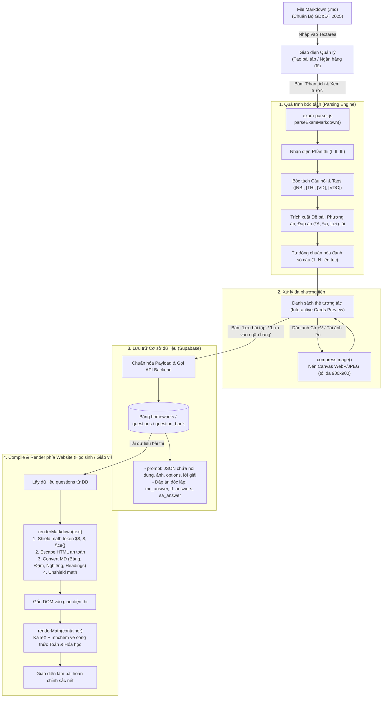

# TÀI LIỆU QUY TRÌNH COMPILE CÂU HỎI TỪ MARKDOWN LÊN HỆ THỐNG WEBSITE (QUESTION.MD)

Tài liệu này mô tả chi tiết toàn bộ quy trình (flow) từ lúc soạn thảo đề thi/câu hỏi bằng định dạng **Markdown (.md)**, qua trình phân tích cú pháp (**Parser Engine**), xử lý hình ảnh, lưu trữ vào cơ sở dữ liệu (**Supabase**) cho đến khi biên dịch (**Compile & Render**) hiển thị trực quan cho học sinh làm bài và giáo viên quản lý.

---

## I. TỔNG QUAN LUỒNG XỬ LÝ (END-TO-END FLOW)



---

## II. QUY CHUẨN CÚ PHÁP FILE MARKDOWN ĐẦU VÀO

Định dạng Markdown được thiết kế bám sát cấu trúc đề thi tốt nghiệp THPT chuẩn Bộ GD&ĐT năm 2025:

### 1. Phân chia các Phần thi
Hệ thống sử dụng các tiêu đề đặc biệt để tự động nhận dạng loại câu hỏi mặc định:
- `=== PHẦN I: TRẮC NGHIỆM NHIỀU LỰA CHỌN (A, B, C, D) ===`
- `=== PHẦN II: TRẮC NGHIỆM ĐÚNG / SAI (4 Ý a, b, c, d) ===`
- `=== PHẦN III: TRẮC NGHIỆM TRẢ LỜI NGẮN (ĐIỀN SỐ) ===`

### 2. Định dạng Câu hỏi & Thẻ phân loại (Tags)
- **Tiêu đề câu:** `[Câu 1]`, `[Câu 2]` hoặc `Câu 1:`, `Câu 1.`
- **Thẻ loại câu hỏi:**
  - `[MC]` hoặc `[MULTIPLE_CHOICE]`: Trắc nghiệm 4 lựa chọn.
  - `[TF]` hoặc `[ĐS]` hoặc `[TRUE_FALSE]`: Trắc nghiệm Đúng / Sai.
  - `[SA]` hoặc `[TLN]` hoặc `[SHORT_ANSWER]`: Trả lời ngắn / Điền số.
- **Thẻ mức độ nhận thức (Difficulty Tags):**
  - `[NB]` hoặc `[NHAN_BIET]`: Nhận biết
  - `[TH]` hoặc `[THONG_HIEU]`: Thông hiểu
  - `[VD]` hoặc `[VAN_DUNG]`: Vận dụng
  - `[VDC]` hoặc `[VAN_DUNG_CAO]`: Vận dụng cao
  *Ví dụ:* `[Câu 1] [TF] [VD] Cho hàm số...`

### 3. Quy tắc đánh dấu Đáp án đúng
- **Phần I (Trắc nghiệm 4 lựa chọn):**
  - Đặt dấu `*` ngay trước chữ cái của đáp án đúng.
  - Ví dụ:
    ```markdown
    A. (1; -2)
    *B. (-1; 2)
    C. x = -1
    D. y = 2
    ```
- **Phần II (Trắc nghiệm Đúng / Sai 4 ý a, b, c, d):**
  - Đặt dấu `*` trước các ý mang giá trị **ĐÚNG**. Ý không có dấu `*` sẽ mặc định là **SAI**.
  - Ví dụ:
    ```markdown
    *a) Hàm số đồng biến trên khoảng (0; 2).
    b) Điểm cực tiểu của hàm số là y = 1.
    *c) Phương trình f(x) = 0 có đúng 3 nghiệm.
    d) Hệ số a < 0.
    ```
- **Phần III (Trả lời ngắn / Điền số):**
  - Khai báo đáp án bằng thẻ: `[Đáp án: <giá trị>]` (hoặc `[ĐA: <giá trị>]`, `[KQ: <giá trị>]`).
  - Khai báo dung sai chấm điểm (nếu có): `[Dung sai: <số thực>]`.
  - Ví dụ:
    ```markdown
    [Đáp án: 2.67]
    [Dung sai: 0.05]
    ```

### 4. Vị trí ảnh và Lời giải chi tiết
- **Thẻ giữ chỗ ảnh:** Đặt `[Ảnh]`, `[Hình ảnh]` hoặc `[Hình vẽ]` ở vị trí cần chèn đồ thị/hình minh họa.
- **Thẻ lời giải:** Bắt đầu bằng dòng `[Lời giải]`, `[Hướng dẫn giải]` hoặc `[Giải chi tiết]`. Toàn bộ nội dung phía dưới đến trước câu tiếp theo sẽ được lưu làm hướng dẫn giải sau khi học sinh nộp bài.

### 5. Công thức Toán học & Hóa học
- **Toán học (KaTeX):**
  - Inline Math: `$y = ax^2 + bx + c$`
  - Display Math: `$$\int_0^1 x^2 \, dx = \frac{1}{3}$$`
- **Hóa học (`mhchem`):**
  - Viết công thức/phương trình trong lệnh `\ce{...}`, ví dụ: `\ce{Fe2O3 + 3CO ->[t^o] 2Fe + 3CO2 ^}`.
  - Parser sẽ tự động bọc thành `$ \ce{...} $` an toàn để KaTeX render.
- **Bảng dữ liệu (GFM Tables):**
  - Hỗ trợ cú pháp Markdown Table:
    ```markdown
    | Chất | Công thức | Trạng thái |
    | :--- | :---: | ---: |
    | Nước | $\ce{H2O}$ | Lỏng |
    ```

---

## III. BÊN TRONG BỘ PHÂN TÍCH (PARSER ENGINE: `exam-parser.js`)

Trình phân tích trong `fe/src/js/utils/exam-parser.js` hoạt động theo mô hình máy trạng thái dòng (Line-by-line State Machine):

### 1. Chu trình đọc từng dòng (`parseExamMarkdown`)
1. **Dò Header Phần thi:**
   - Khớp regex `^===\s*PHẦN\s*(I|II|III)\b` để cập nhật `currentSectionType`.
2. **Dò Bắt đầu câu hỏi:**
   - Khớp `^\[(?:Câu|Bài)\s*(\d+)\](.*)$`.
   - Lưu trữ (Flush) câu hỏi trước đó vào mảng kết quả.
   - Bóc tách toàn bộ tag trong ngoặc vuông `[...]` ở phần dư sau số câu để xác định `questionType` và `difficulty`.
   - Khởi tạo object câu hỏi với mode đọc ban đầu là `PROMPT`.
3. **Chuyển chế độ đọc:**
   - Khi gặp `[Lời giải]` -> Đổi `currentMode = 'EXPLANATION'`.
   - Khi gặp `[Ảnh]` -> Đánh dấu `hasImagePlaceholder = true`.
4. **Trích xuất phương án & đáp án:**
   - Ở `MULTIPLE_CHOICE`: Khớp `/^(\*)?\s*([A-D])\s*[.:)]\s*(.*)$/i` -> Lấy `id`, `text`, và nếu có `*` thì gán `mcAnswer = optId`.
   - Ở `TRUE_FALSE`: Khớp `/^(\*)?\s*([a-d])\s*[.:)]\s*(.*)$/i` -> Gán `tfAnswers[subId] = isTrue`.
   - Ở `SHORT_ANSWER`: Khớp `[Đáp án: ...]` và `[Dung sai: ...]`.
5. **Kiểm tra và Chuẩn hóa số thứ tự (Auto Renumbering):**
   - Đảm bảo câu hỏi có số thứ tự liên tục $1, 2, 3, \dots, N$ duy nhất trên toàn bài thi, tránh trùng lặp khi người dùng gom từ nhiều nguồn.

### 2. Cấu trúc Object sau khi Parse
```javascript
{
  questionNumber: 1,
  questionType: "MULTIPLE_CHOICE", // "MULTIPLE_CHOICE" | "TRUE_FALSE" | "SHORT_ANSWER"
  difficulty: "THONG_HIEU",       // "NHAN_BIET" | "THONG_HIEU" | "VAN_DUNG" | "VAN_DUNG_CAO"
  promptText: "Cho hàm số $y = f(x)$ có đồ thị như hình vẽ...",
  options: [
    { id: "A", text: "$(1; -2)$" },
    { id: "B", text: "$(-1; 2)$" }
  ],
  mcAnswer: "B",
  tfAnswers: {},
  saAnswer: "",
  saTolerance: 0,
  explanation: "Dựa vào đồ thị, điểm cực đại là (-1; 2)...",
  hasImagePlaceholder: true,
  imageUrl: "",
  points: 0.25
}
```

---

## IV. TƯƠNG TÁC GIAO DIỆN & XỬ LÝ HÌNH ẢNH (`create-hw.js`)

Sau khi parse xong văn bản Markdown, giao diện cung cấp các công cụ trực quan hóa mạnh mẽ:

1. **Card Preview & Inline Edit:**
   - Mỗi câu hỏi được render thành một Card trực quan với đề bài, danh sách phương án, đáp án đúng được highlight, và nút sửa nội dung nhanh.
2. **Dán ảnh siêu tốc từ Clipboard (`Ctrl + V`):**
   - Giáo viên dùng công cụ chụp ảnh màn hình (như Windows Snipping Tool `Win + Shift + S`) chụp hình từ file Word hoặc PDF.
   - Click vào khung ảnh của câu hỏi và bấm **`Ctrl + V`**.
   - Trình duyệt bắt sự kiện `paste`, trích xuất file ảnh Blob.
3. **Nén ảnh tự động phía Client (`compressImage`):**
   - Ảnh được đưa vào HTML5 Canvas.
   - Resize tỷ lệ về tối đa `900x900px`.
   - Chuyển đổi định dạng sang **WebP** (hoặc JPEG fallback) với mức nén chất lượng `0.82`.
   - Giúp dung lượng ảnh giảm $80\% - 90\%$ (thường chỉ còn 20KB - 80KB), đảm bảo tải đề thi siêu nhanh mà hình vẽ vẫn rõ nét.
4. **Đồng bộ hai chiều (Two-way sync):**
   - Khi chỉnh sửa đề bài, đáp án hoặc độ khó trực tiếp trên Card, hàm `formatExamToMarkdown()` sẽ tự động biên dịch ngược toàn bộ câu hỏi thành văn bản Markdown chuẩn trong khung soạn thảo.

---

## V. ĐÓNG GÓI LƯU TRỮ VÀO CƠ SỞ DỮ LIỆU (SUPABASE)

Khi bấm **"Lưu bài tập"** hoặc nạp vào **"Ngân hàng đề thi"**, hệ thống chuyển đổi câu hỏi thành cấu trúc lưu trữ bảo mật:

```javascript
{
  id: "q_1",
  questionNumber: 1,
  questionType: "MULTIPLE_CHOICE",
  difficulty: "THONG_HIEU",
  points: 0.25,
  // Nội dung đề bài đóng gói JSON vào cột prompt
  prompt: JSON.stringify({
    isInteractive: true,
    text: q.promptText,
    imageUrl: q.imageUrl,
    options: q.options,
    statements: q.statements,
    explanation: q.explanation,
    difficulty: q.difficulty
  }),
  // Các trường đáp án lưu riêng biệt để bảo mật khi học sinh nhận đề
  mcAnswer: "B",
  tfAnswers: { a: true, b: false, c: true, d: false },
  saAnswer: "2.67",
  saTolerance: 0.05
}
```

- **Tính bảo mật:** Khi học sinh làm bài thi (`exam-room.js`), backend Edge Function chỉ trả về trường `prompt` và thông tin định danh câu hỏi, tách hoàn toàn các trường `mcAnswer`, `tfAnswers`, `saAnswer` cho đến khi học sinh hoàn thành nộp bài.

---

## VI. BIÊN DỊCH & RENDER PHÍA CLIENT (`renderMarkdown` & `renderMath`)

Khi học sinh làm bài hoặc giáo viên xem lại bài thi, quy trình compile HTML và công thức Toán/Hóa diễn ra qua 2 giai đoạn:

### Giai đoạn 1: `renderMarkdown(text)` - Bảo vệ Toán học & Chuyển đổi Markdown
1. **Shield Math Blocks:**
   - Dùng Regex tìm tất cả các khối công thức:
     - Khối Display Math: `$$...$$`, `\[...\]`
     - Khối Inline Math: `$...$`, `\(...\)`
     - Khối Hóa học: `\ce{...}`
   - Thay thế các khối trên bằng Token giữ chỗ độc nhất (ví dụ: `@@MATHXTOKENX0XTOKENXMATH@@`).
   - *Mục đích:* Ngăn các ký tự đặc biệt của LaTeX (như `_`, `*`, `<`, `>`) bị trình parser Markdown và bộ escape HTML làm biến dạng.
2. **HTML Entity Escaping:**
   - Escape các ký tự `<`, `>`, `&`, `"` để chống tấn công XSS.
3. **Parse Markdown elements:**
   - Render Table chuẩn GFM sang cấu trúc `<table>`.
   - Render Headings `#`, `##`, `###`.
   - Render Bold `**text**`, Italic `*text*`, Code `` `code` ``.
   - Render Danh sách `* item` hoặc `- item` thành `<ul><li>...</li></ul>`.
   - Render xuống dòng kép thành spacer, xuống dòng đơn thành `<br>`.
4. **Unshield Math Blocks:**
   - Thay thế ngược lại các token `@@MATHXTOKENX...@@` thành chuỗi công thức LaTeX nguyên bản.

### Giai đoạn 2: `renderMath(container)` - KaTeX & mhchem
- Kích hoạt hàm `window.renderMathInElement(container, options)`:
  - Cấu hình delimiters:
    - `{ left: '$$', right: '$$', display: true }`
    - `{ left: '$', right: '$', display: false }`
    - `{ left: '\\(', right: '\\)', display: false }`
    - `{ left: '\\[', right: '\\]', display: true }`
  - Thư viện `KaTeX` tích hợp module `mhchem` sẽ quét toàn bộ cây DOM và chuyển đổi các công thức LaTeX, phương trình hóa học thành HTML/SVG mượt mà, sắc nét, không bị giật lag.

---

## VII. ĐỀ THI MẪU HOÀN CHỈNH (TEMPLATE CHUẨN)

Dưới đây là một đề thi mẫu chuẩn gồm cả 3 phần có thể copy trực tiếp vào hệ thống:

```markdown
# ĐỀ THI MINH HỌA TỐT NGHIỆP THPT

=== PHẦN I: TRẮC NGHIỆM NHIỀU LỰA CHỌN (A, B, C, D) ===

[Câu 1] [NB]
Cho hàm số $y = f(x)$ có bảng biến thiên như hình vẽ.
[Ảnh]
Hàm số đã cho đồng biến trên khoảng nào dưới đây?
A. $(-\infty; 1)$
*B. $(0; 2)$
C. $(1; 3)$
D. $(2; +\infty)$
[Lời giải]
Dựa vào bảng biến thiên, trên khoảng $(0; 2)$ đạo hàm $f'(x) > 0$ nên hàm số đồng biến.

[Câu 2] [TH]
Tiến hành phản ứng este hóa giữa axit axetic và ancol etylic:
$$\ce{CH3COOH + C2H5OH <=>[H2SO4 đặc, t^o] CH3COOC2H5 + H2O}$$
Chất $\ce{CH3COOC2H5}$ tạo thành có tên gọi là:
*A. Etyl axetat
B. Metyl fomat
C. Etyl propionat
D. Vinyl axetat
[Lời giải]
Este $\ce{CH3COOC2H5}$ được cấu tạo từ gốc axetat ($\ce{CH3COO-}$) và gốc etyl ($\ce{-C2H5}$) nên có tên là Etyl axetat.


=== PHẦN II: TRẮC NGHIỆM ĐÚNG / SAI (4 Ý a, b, c, d) ===

[Câu 3] [TF] [VD]
Cho khối chóp $S.ABCD$ có đáy $ABCD$ là hình vuông cạnh $a$. Cạnh bên $SA \perp (ABCD)$ và $SA = a\sqrt{3}$.
[Ảnh]
Xét tính Đúng / Sai của các khẳng định sau:
*a) Đường thẳng $SA$ vuông góc với mặt phẳng $(ABCD)$.
*b) Góc giữa đường thẳng $SB$ và $(ABCD)$ bằng $60^\circ$.
c) Thể tích khối chóp $S.ABCD$ bằng $a^3\sqrt{3}$.
*d) Khoảng cách từ điểm $A$ đến mặt phẳng $(SBD)$ bằng $\frac{a\sqrt{21}}{7}$.
[Lời giải]
- Ý a ĐÚNG: Giả thiết bài toán cho $SA \perp (ABCD)$.
- Ý b ĐÚNG: Góc giữa $SB$ và đáy là $\widehat{SBA}$. $\tan \widehat{SBA} = \frac{SA}{AB} = \sqrt{3} \Rightarrow \widehat{SBA} = 60^\circ$.
- Ý c SAI: $V = \frac{1}{3} S_{ABCD} \cdot SA = \frac{a^3\sqrt{3}}{3}$.
- Ý d ĐÚNG: Áp dụng hệ thức lượng ta tính được $d = \frac{a\sqrt{21}}{7}$.


=== PHẦN III: TRẮC NGHIỆM TRẢ LỜI NGẮN (ĐIỀN SỐ) ===

[Câu 4] [SA] [VD]
Tính diện tích hình phẳng giới hạn bởi đồ thị $y = x^2 - 2x$, trục hoành $Ox$ và hai đường thẳng $x = 0$, $x = 3$. (Làm tròn đến chữ số thập phân thứ hai).
[Đáp án: 2.67]
[Dung sai: 0.05]
[Lời giải]
Diện tích $S = \int_0^3 |x^2 - 2x| \, dx = \frac{8}{3} \approx 2,67$.
```
